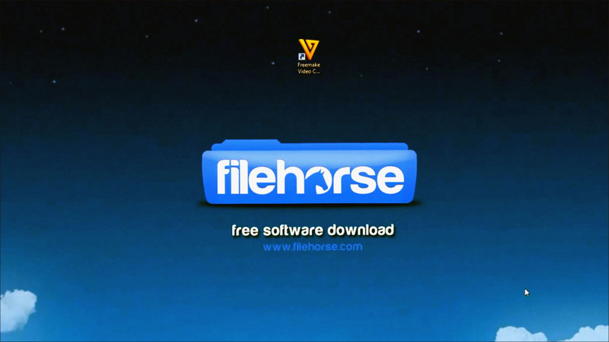
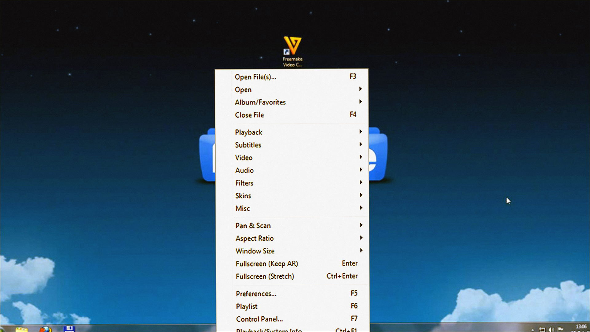
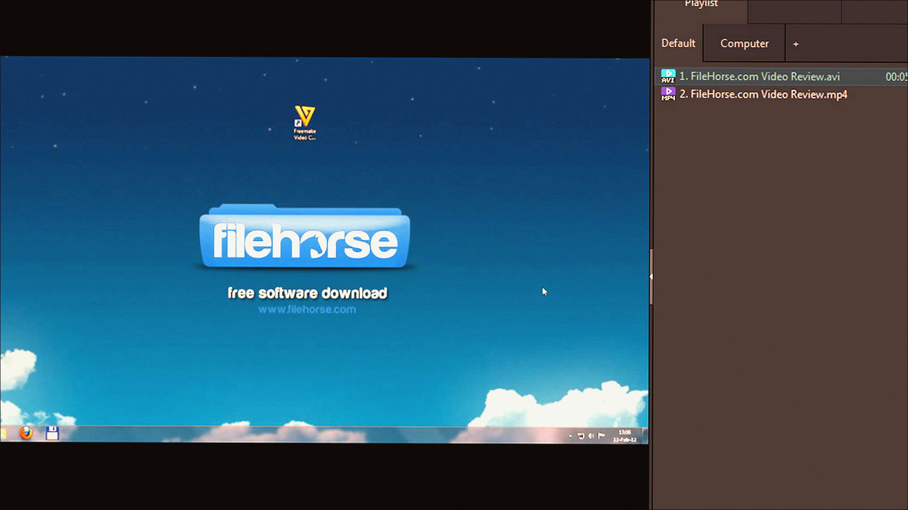

# Windows notes: PotPlayer

**Daum** · 1.7 · 194 MB · Video catalog

[Open card](https://moggydayprogram.com/programs/potplayer) · [English](https://moggydayprogram.com/en/programs/potplayer) · [GitHub Pages](https://thresholdtivibrate.github.io/potplayer-windows/?lang=en)

  
  
  

Плеер сильнее KMPlayer. Русский.

PotPlayer on Windows 10/11 x64. 194 MB. Requirements, screenshots, MoggyDay Launcher.

Get it from the catalog card, not from this repository.

| Field | Value |
| --- | --- |
| Build | 1.7 |
| OS | Windows 10/11 x64 |
| Pages | https://thresholdtivibrate.github.io/potplayer-windows/ |

- [VLC media player](https://moggydayprogram.com/programs/vlc)
- [KMPlayer](https://moggydayprogram.com/programs/kmplayer)
